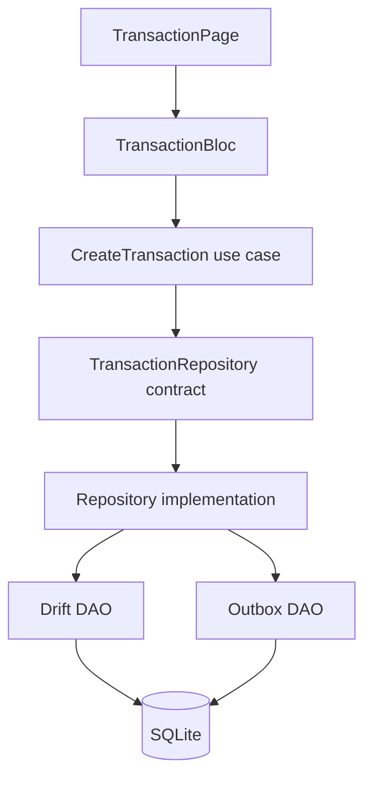

# Flutter Clean Architecture and BLoC Specification
- Document ID: ARCH-002 · Status: Proposed.

## Layers
**Presentation:** pages/widgets/navigation + BLoC/Cubit. Render state and dispatch intent; no SQL/HTTP or authoritative accounting calculations.

**Domain:** entities/value objects, repository contracts, use cases, validators and financial rules. Prefer pure Dart; no Flutter, Drift or Dio dependency.

**Data:** repository implementations, DAOs, API/data sources, serialization models and mappers. Translate between persistence/network models and domain entities.

## Feature-first structure
```text
lib/
  main.dart  bootstrap.dart
  app/{app.dart,router/,theme/,localization/}
  core/{database/,network/,security/,sync/,errors/,logging/,utilities/}
  features/
    authentication/{data/{datasources,models,mappers,repositories},domain/{entities,repositories,usecases},presentation/{bloc,pages,widgets}}
    profiles/ dashboard/ accounts/ transactions/ categories/
    budgets/ savings_goals/ recurring/ loans/ analytics/ reports/
    import_export/ settings/
  shared/{widgets,formatters,extensions,enums}
```
Each feature should follow `data/{datasources,models,mappers,repositories}`, `domain/{entities,repositories,usecases}`, `presentation/{bloc,pages,widgets}`.

## Bloc versus Cubit
Use Bloc for event-rich workflows, multiple event sources, ordering/concurrency requirements or complex transitions. Use Cubit for smaller command-oriented state (e.g. simple selected view/filter) where event objects add little value. Do not create one BLoC per widget; assign state by feature/use-case boundary.

## States
Prefer immutable typed states. Read flows often need initial/loading/loaded/empty/partial-or-stale/offline-cached/failure. Avoid boolean combinations that allow impossible states. Loaded data may carry `isStale`, `lastUpdatedAt` and refresh status. Preserve form input on recoverable errors. Local commit and cloud sync are separate transitions.

## Concurrency
Search/filter typing: debounce/restartable so stale results cannot win. Mutations: serialize where order matters and enforce idempotency in data layer. Independent reads can run concurrently only with deterministic state merging. Profile switch cancels/invalidates old work and rejects late results. Test rapid repeated events and races.

## Dependency injection and errors
Construct DB, secure storage, API, repositories and use cases in the composition root. Inject contracts into BLoCs. Map low-level exceptions to typed failures; never show raw SQL, stack traces, server internals or sensitive payloads. Preserve causes only in redacted diagnostics.

## Naming and tests
Dart filenames `snake_case.dart`, types `UpperCamelCase`, members `lowerCamelCase`. Use `bloc_test` for BLoC behaviour; test domain via repository contracts; use isolated DB for DAO/repository integration. Test profile switching, stale requests, repeated events and duplicate saves.

## Dependency flow


## Non-negotiable rules
No DB/network in widgets; no finance calculation in BLoC; no BuildContext in domain/data; no profile-less repository API for profile-owned data; no swallowed exceptions; BLoC must be testable without a screen.
