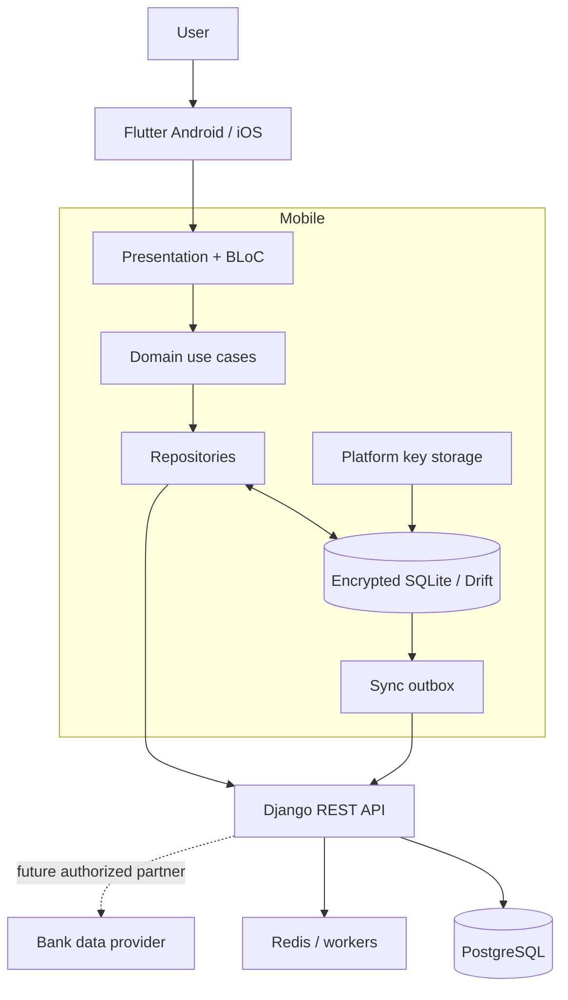

# System Architecture
- Document ID: ARCH-001 · Status: Proposed; proof-of-concept/review required.

## Architecture style
Flutter mobile client with feature-first Clean Architecture, BLoC/Cubit presentation coordination, Drift/SQLite local persistence and a local-first sync boundary. Django REST Framework + PostgreSQL is proposed for identity, profile membership, devices, synchronization and future integration services.

## Context diagram

## Trust boundaries
Device OS/app process; encrypted DB + key store; public network/TLS; backend API/authorization; PostgreSQL/server secrets; external services (push, storage, FX provider, future bank partner). Each boundary needs explicit authentication, authorization, validation and logging rules.

## Mobile responsibilities
Render UI; coordinate BLoC; execute deterministic domain use cases; persist core records atomically; protect secrets; queue sync durably; distinguish local save from cloud sync; enforce profile scope.

## Backend responsibilities
Authenticate and manage sessions; authorize profile memberships; accept idempotent sync; provide incremental changes; manage devices/audit metadata; run background jobs; validate client submissions and enforce server-side invariants. Never trust a client-supplied balance as authoritative.

## Offline/data ownership
A local write is successful only after its DB transaction commits. Sync is separate: pending, syncing, synced, failed or conflict. Network failure does not undo committed local data. The canonical authority model for shared profiles must be finalized before collaboration ships.

## Constraints
No Drift in widgets; no SQL/Dio in BLoCs; domain does not depend on Flutter/Drift/Dio; no float for authoritative money; posted journals immutable; no bank credentials/tokens in ordinary local tables or analytics.

## Proposed deployment
Django API behind HTTPS reverse proxy/load balancer; PostgreSQL; Redis/worker only where justified; protected object storage for approved attachments/backups; managed secret store. Validate encryption, migrations, backup/restore, BLoC vertical slice, idempotent sync and shared-profile authority before production.
